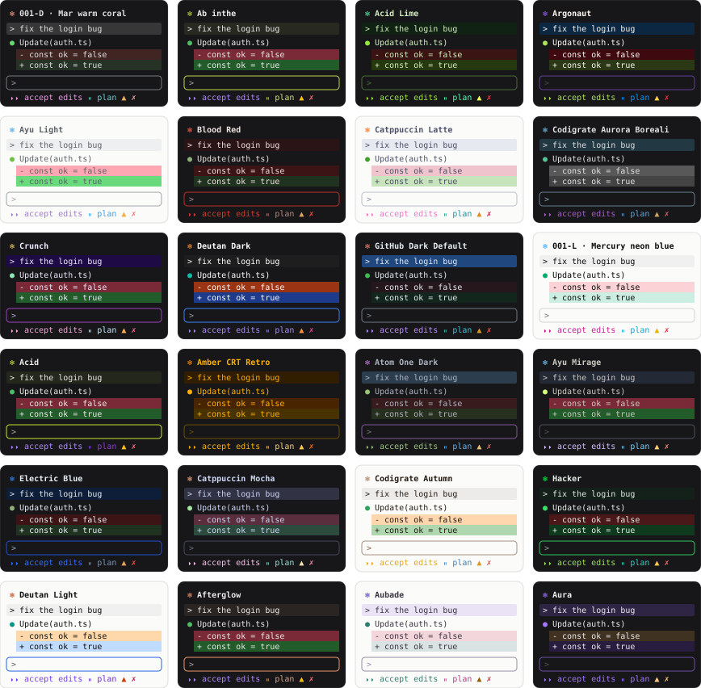

# Claude Code Themes

A studio for Claude Code themes: design one, preview it live, install it. Animated backdrops for the desktop app and colour themes for the terminal. One command, no other repos.

```
npx github:anhnt256/claude-code-themes
```

That opens the Studio in your browser. **Install** puts what you made straight into Claude Code.

**[Make a backdrop →](https://anhnt256.github.io/claude-code-themes/backdrop.html)** · **[Make a terminal theme →](https://anhnt256.github.io/claude-code-themes/studio.html)** · **[Browse the gallery →](https://anhnt256.github.io/claude-code-themes/)**

## Backdrops for the desktop app

An animated scene behind the conversation in the Code tab. Illustrated rooms that stay in the margins: a cat asleep on a desk, a puppy with a ball, an evening sky with a train going home, a pinboard of notes and photos. And wide landscapes: a koi pond, falling petals, an aurora, fireflies, stars, snow, rain.

- **Pick a scene and a colour**; the whole picture is painted from that one colour, dark or light
- **Shuffle** for a new arrangement, or a different cat or dog; set how much is in it and how fast it moves
- **See it behind the app** as you change it, with the panel blur and opacity you choose
- **Install** builds it as a plugin on your machine and adds it to Claude Code; restart the desktop app to see it

Needs Claude Code 2.1.323 or newer. `/<name> off` turns a backdrop off.

## Terminal themes

- **Start anywhere**: a theme from the gallery, one seed colour, a random palette, or a theme file you drop in
- **Every colour**: all 62 tokens, grouped and searchable; click anything in the preview to find its colour
- **Live preview** on a dark or light terminal, with the background you actually use
- **Readable by default**: pairs that are hard to read are listed, with a one-click fix
- **Undo, redo, share**: the link carries the whole theme
- **Install** in one click when run locally; online it gives you one command to paste

## Command line

```
npx github:anhnt256/claude-code-themes list
npx github:anhnt256/claude-code-themes preview dracula
npx github:anhnt256/claude-code-themes install dracula
npx github:anhnt256/claude-code-themes new "#3b82f6" --name "Blue Sky" --install
npx github:anhnt256/claude-code-themes new "#e8743b" --scene koi --name "My Pond" --install
npx github:anhnt256/claude-code-themes check my-theme.json
```

Or take the whole collection as a plugin:

```
/plugin marketplace add anhnt256/claude-code-themes
/plugin install themes@claude-code-themes
```

[](https://anhnt256.github.io/claude-code-themes/)

Themes that look alike are counted once. [THEMES.md](THEMES.md) lists each one with its author and source.

## Desktop app

<!-- desktop -->
<table>
<tr><td width="33%" align="center"><a href="https://github.com/anthropics/claude-plugins-official/tree/HEAD/plugins/theme-examples"></a><br><b>Koi Mosaic</b><br><sub>Anthropic</sub></td><td width="33%" align="center"><a href="https://github.com/markimoo09/claude-code-themes"></a><br><b>Pixel Cats</b><br><sub>markimoo09</sub></td><td width="33%" align="center"><a href="https://github.com/anthropics/claude-plugins-official/tree/HEAD/plugins/theme-examples"></a><br><b>Paper Garden</b><br><sub>Anthropic</sub></td></tr>
<tr><td width="33%" align="center"><a href="https://github.com/ishuagrawal/claude-code-themes"></a><br><b>Rainy Window</b><br><sub>ishuagrawal</sub></td><td width="33%" align="center"><a href="https://github.com/anthropics/claude-plugins-official/tree/HEAD/plugins/theme-examples"></a><br><b>Honu Lagoon</b><br><sub>Anthropic</sub></td><td width="33%" align="center"><a href="https://github.com/Brezn610/snowfall-theme"></a><br><b>Snowfall</b><br><sub>Brezn610</sub></td></tr>
<tr><td width="33%" align="center"><a href="https://github.com/AkkiCode06/claude-backdrops"></a><br><b>Backdrop</b><br><sub>AkkiCode06</sub></td><td width="33%" align="center"><a href="https://github.com/anthropics/claude-plugins-official/tree/HEAD/plugins/theme-examples"></a><br><b>Night Reef</b><br><sub>Anthropic</sub></td><td width="33%" align="center"><a href="https://github.com/kimthangk/claude-theme-lewell"></a><br><b>Christmas Night &amp; City Tour</b><br><sub>kimthangk</sub></td></tr>
</table>
<!-- /desktop -->

The [gallery](https://anhnt256.github.io/claude-code-themes/) has all of them, each with its author and install command.

## Sources

<!-- stats -->
**57 desktop themes** · **93 terminal themes** in one install · **264 more** linked

| Source | Themes | Licence | |
| --- | ---: | --- | --- |
| [matcra587/claude-themes](https://github.com/matcra587/claude-themes) | 106 | none | linked |
| [livlign/ccthemes](https://github.com/livlign/ccthemes) | 30 | MIT | included |
| [CodySpooner/ClaudeCodeThemes](https://github.com/CodySpooner/ClaudeCodeThemes) | 5 | MIT | included |
| [Shahfarzane/claude-code-themes](https://github.com/Shahfarzane/claude-code-themes) | 2 | MIT | included |
| [bgmacris/claude-code-themes](https://github.com/bgmacris/claude-code-themes) | 2 | MIT | included |
| [kamegg13/claude-code-themes](https://github.com/kamegg13/claude-code-themes) | 11 | MIT | included |
| [notgabriels-sys/claude-code-50-dark-themes](https://github.com/notgabriels-sys/claude-code-50-dark-themes) | 9 | MIT | included |
| [rezzminator/claude-code-tokyo-night](https://github.com/rezzminator/claude-code-tokyo-night) | 1 | none | linked |
| [amondnet/claude-code-themes](https://github.com/amondnet/claude-code-themes) | 8 | MIT | included |
| [chrisathook/claude-code-cli-themes](https://github.com/chrisathook/claude-code-cli-themes) | 3 | MIT | included |
| [codigrate/claude-code-themes](https://github.com/codigrate/claude-code-themes) | 6 | MIT | included |
| [khtdr/claude-code-themes](https://github.com/khtdr/claude-code-themes) | 76 | none | linked |
| [LinXiaoTao/themecc](https://github.com/LinXiaoTao/themecc) | 16 | MIT | included |
| [nils44344/claude-code-themes](https://github.com/nils44344/claude-code-themes) | 81 | none | linked |
| [stefangruehn/claude-code-theme](https://github.com/stefangruehn/claude-code-theme) | 1 | MIT | included |
<!-- /stats -->

Themes under an open licence are included, each with its licence in [`licenses/`](licenses). The rest are linked from the gallery and stay in their own repos.

## Add a theme

Make it in the Studio, save the file into [`themes/`](themes) and open a pull request. To add a whole repo of themes, add it to [`sources.json`](sources.json); the weekly sync picks up every theme file in it.

## Credits

The Studio and CLI are written for this repo. The backdrop plugins follow the mod recipe in Anthropic's docs and its theme-examples plugin. The terminal side was shaped by studying three MIT projects: [claude-code-theme-generator](https://github.com/denesszabo/claude-code-theme-generator) by denesszabo, [claude-code-theme-editor](https://github.com/FEIF-L/claude-code-theme-editor) by FEIF-L and [claude-code-theme-designer](https://github.com/aleslanger/claude-code-theme-designer) by aleslanger, whose capture of Claude Code's base colours [`docs/tokens.json`](docs/tokens.json) builds on. Much of the desktop list and the previews in [`docs/previews/`](docs/previews) come from [buildwithclaude](https://github.com/davepoon/buildwithclaude) (MIT); other previews load from their authors' repos.

## Licence

[MIT](LICENSE) for this repo. Each included theme keeps its author's licence, in [`licenses/`](licenses).
