# Claude Code Themes

Every theme for Claude Code, in one place.

**[Browse the gallery →](https://anhnt256.github.io/claude-code-themes/)**

## Desktop app

<!-- desktop -->
<table>
<tr><td width="33%" align="center"><a href="https://github.com/anthropics/claude-plugins-official/tree/HEAD/plugins/theme-examples"></a><br><b>Koi Mosaic</b><br><sub>Anthropic</sub></td><td width="33%" align="center"><a href="https://github.com/markimoo09/claude-code-themes"></a><br><b>Pixel Cats</b><br><sub>markimoo09</sub></td><td width="33%" align="center"><a href="https://github.com/anthropics/claude-plugins-official/tree/HEAD/plugins/theme-examples"></a><br><b>Paper Garden</b><br><sub>Anthropic</sub></td></tr>
<tr><td width="33%" align="center"><a href="https://github.com/ishuagrawal/claude-code-themes"></a><br><b>Rainy Window</b><br><sub>ishuagrawal</sub></td><td width="33%" align="center"><a href="https://github.com/anthropics/claude-plugins-official/tree/HEAD/plugins/theme-examples"></a><br><b>Honu Lagoon</b><br><sub>Anthropic</sub></td><td width="33%" align="center"><a href="https://github.com/Brezn610/snowfall-theme"></a><br><b>Snowfall</b><br><sub>Brezn610</sub></td></tr>
<tr><td width="33%" align="center"><a href="https://github.com/AkkiCode06/claude-backdrops"></a><br><b>Backdrop</b><br><sub>AkkiCode06</sub></td><td width="33%" align="center"><a href="https://github.com/anthropics/claude-plugins-official/tree/HEAD/plugins/theme-examples"></a><br><b>Night Reef</b><br><sub>Anthropic</sub></td><td width="33%" align="center"><a href="https://github.com/kimthangk/claude-theme-lewell"></a><br><b>Christmas Night &amp; City Tour</b><br><sub>kimthangk</sub></td></tr>
</table>
<!-- /desktop -->

The [gallery](https://anhnt256.github.io/claude-code-themes/) has all of them, each with its author and install command.

## Terminal

[](https://anhnt256.github.io/claude-code-themes/)

```
/plugin marketplace add anhnt256/claude-code-themes
/plugin install themes@claude-code-themes
```

Then run `/theme`. To take one theme only, copy its file from [`themes/`](themes) into `~/.claude/themes/`.

Themes that look alike are counted once. [THEMES.md](THEMES.md) lists each one with its author and source.

## Sources

<!-- stats -->
**57 desktop themes** · **93 terminal themes** in one install · **264 more** linked

| Source | Themes | Licence | |
| --- | ---: | --- | --- |
| [matcra587/claude-themes](https://github.com/matcra587/claude-themes) | 106 | none | linked |
| [livlign/ccthemes](https://github.com/livlign/ccthemes) | 30 | MIT | included |
| [CodySpooner/ClaudeCodeThemes](https://github.com/CodySpooner/ClaudeCodeThemes) | 5 | MIT | included |
| [Shahfarzane/claude-code-themes](https://github.com/Shahfarzane/claude-code-themes) | 2 | MIT | included |
| [bgmacris/claude-code-themes](https://github.com/bgmacris/claude-code-themes) | 2 | MIT | included |
| [kamegg13/claude-code-themes](https://github.com/kamegg13/claude-code-themes) | 11 | MIT | included |
| [notgabriels-sys/claude-code-50-dark-themes](https://github.com/notgabriels-sys/claude-code-50-dark-themes) | 9 | MIT | included |
| [rezzminator/claude-code-tokyo-night](https://github.com/rezzminator/claude-code-tokyo-night) | 1 | none | linked |
| [amondnet/claude-code-themes](https://github.com/amondnet/claude-code-themes) | 8 | MIT | included |
| [chrisathook/claude-code-cli-themes](https://github.com/chrisathook/claude-code-cli-themes) | 3 | MIT | included |
| [codigrate/claude-code-themes](https://github.com/codigrate/claude-code-themes) | 6 | MIT | included |
| [khtdr/claude-code-themes](https://github.com/khtdr/claude-code-themes) | 76 | none | linked |
| [LinXiaoTao/themecc](https://github.com/LinXiaoTao/themecc) | 16 | MIT | included |
| [nils44344/claude-code-themes](https://github.com/nils44344/claude-code-themes) | 81 | none | linked |
| [stefangruehn/claude-code-theme](https://github.com/stefangruehn/claude-code-theme) | 1 | MIT | included |
<!-- /stats -->

Themes under an open licence are included, each with its licence in [`licenses/`](licenses). The rest are linked from the gallery and stay in their own repos.

## Make your own

- `/theme` → **New custom theme**, built into Claude Code
- Any terminal theme in the gallery opens in a colour editor
- [claude-backdrops](https://github.com/AkkiCode06/claude-backdrops), custom backdrops for the desktop app
- [claude-code-theme-generator](https://github.com/denesszabo/claude-code-theme-generator), a browser editor with JSON export
- [claude-code-theme-editor](https://github.com/FEIF-L/claude-code-theme-editor), a visual editor for every colour token
- [claude-code-theme-designer](https://github.com/aleslanger/claude-code-theme-designer), design and install from the terminal
- [tweakcc](https://github.com/Piebald-AI/tweakcc), for deeper changes to Claude Code itself

## Add a theme

Add your repo to [`sources.json`](sources.json) and open a pull request: `terminal` for a repo of colour themes, `desktop` for a desktop theme with a preview image.

```
GITHUB_TOKEN=$(gh auth token) node scripts/sync.mjs
```

## Licence

[MIT](LICENSE) for this repo. Each included theme keeps its author's licence. Much of the desktop list and the previews in [`docs/previews/`](docs/previews) come from [buildwithclaude](https://github.com/davepoon/buildwithclaude) (MIT); other previews load from their authors' repos.
